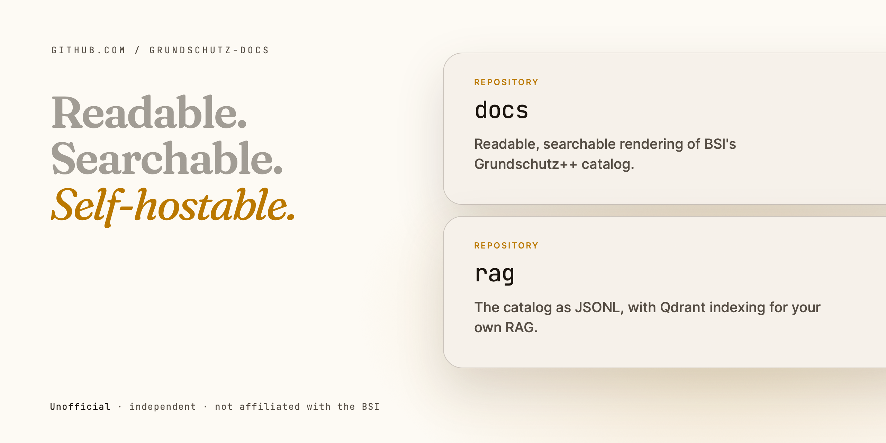
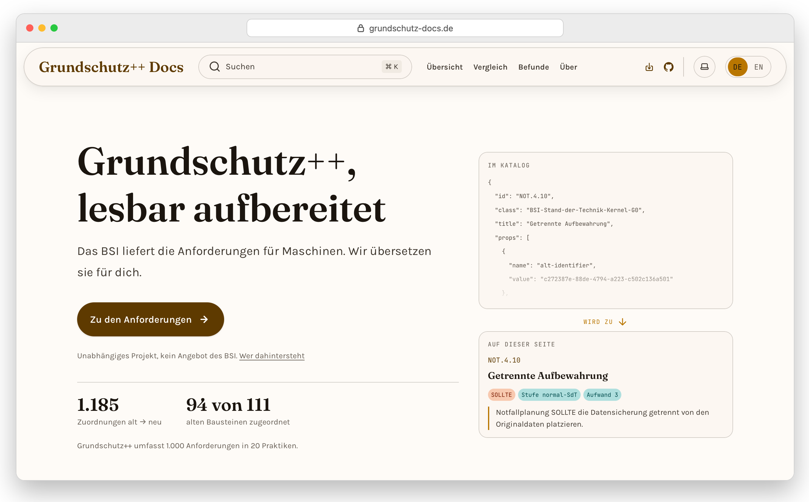

<picture>
  <source media="(prefers-color-scheme: dark)" srcset="https://raw.githubusercontent.com/grundschutz-docs/.github/main/profile/images/banner-dark.png">
  
</picture>

The banner is an illustration, not a screenshot.

# Grundschutz-Docs

The BSI ships its Grundschutz++ security catalog as a 10k+ line OSCAL
JSON file — built for tooling, not for reading. **[grundschutz-docs/docs](https://github.com/grundschutz-docs/docs)**
turns it into a site worth sitting down with: full-text search, one
permalink per control, a side-by-side mapping to the old
IT-Grundschutz-Kompendium, and a public register of inconsistencies found
along the way.

Unofficial and independent — not affiliated with, endorsed by, or
produced by the Bundesamt für Sicherheit in der Informationstechnik (BSI).

MIT-licensed, self-hostable, no closed-off tier. What's here is
everything there is.

<a href="https://grundschutz-docs.de">
  <picture>
    <source media="(prefers-color-scheme: dark)" srcset="https://raw.githubusercontent.com/grundschutz-docs/.github/main/profile/images/home-dark.png">
    
  </picture>
</a>
 
The start page: the BSI's raw OSCAL entry above, the readable page it becomes below. German UI, English landing page at <a href="https://grundschutz-docs.de/en/">/en/</a>.

**[→ grundschutz-docs.de](https://grundschutz-docs.de)** · [Source code and README](https://github.com/grundschutz-docs/docs#readme)
